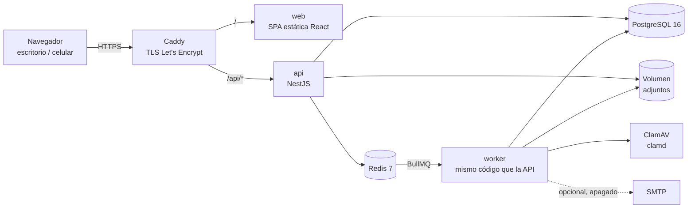

# Arquitectura

## Vista general



Solo Caddy expone puertos (80/443). PostgreSQL, Redis y ClamAV viven en una red Docker interna; los adjuntos, en un volumen.

## Componentes

| Componente                             | Responsabilidad                                                                                                                                                                                                                                                  |
| -------------------------------------- | ---------------------------------------------------------------------------------------------------------------------------------------------------------------------------------------------------------------------------------------------------------------- |
| `apps/web`                             | SPA React + Vite + TypeScript + Tailwind + shadcn/ui. React Router, TanStack Query, react-hook-form + zod.                                                                                                                                                       |
| `apps/api`                             | API REST NestJS. Auth, RBAC, dominios de negocio, emisión de URLs firmadas, encolado de jobs.                                                                                                                                                                    |
| worker (`apps/api/src/worker.main.ts`) | Mismo código que la API en otro proceso ([ADR 0014](adr/0014-worker-same-codebase.md)). Consumidores BullMQ: antivirus, extracción de texto/OCR, fragmentación, SLA, notificaciones, mail opcional, cierre automático (deshabilitado por defecto), importadores. |
| `packages/shared`                      | Schemas zod, enums, tipos y la lógica pura del calendario hábil / SLA (usada por api y worker).                                                                                                                                                                  |
| `packages/db`                          | Schema Prisma, migraciones (incluye SQL manual para FTS) y cliente compartido.                                                                                                                                                                                   |

## Organización por dominio (backend)

```
apps/api/src/
  auth/          login, MFA, sesiones, política de contraseñas
  users/         alta por Admin, roles, catálogos de área/depósito
  audit/         log inmutable
  settings/      SLA, horario hábil, feriados, categorías, mail
  tickets/       tickets, comentarios, tiempo, SLA, derivaciones
  problems/      problemas y resolución en bloque
  improvements/  mejoras, kanban
  clients/       maestro de clientes y contactos
  integrations/  integraciones, cotizaciones, "cómo funciona"
  knowledge/     artículos, documentos, fragmentos, búsqueda
  files/         storage, adjuntos, URLs firmadas
  notifications/ campana + EmailSender
  dashboard/     indicadores agregados (usa los mismos filtros que las listas: tickets/ticket-filters.ts)
  privacy/       exportación / anonimización por titular
```

Cada dominio expone **servicios de aplicación** independientes de HTTP (ej. `TicketService.create(command, actor)`). Los controllers son una capa delgada. Esto permite que futuros canales (mail entrante, chatbot) usen los mismos servicios — ver [ADR 0013](adr/0013-input-channels-extensibility.md).

## Flujos principales

### Alta de ticket

1. Usuario completa el formulario guiado (tipo → sistema → datos → adjuntos).
2. Los adjuntos se suben antes del envío a `quarantine/` y quedan `PENDING_SCAN`.
3. Antes de enviar, la web consulta artículos públicos similares (`GET /api/knowledge/suggest?q=`).
4. `POST /api/tickets` → número `TLI-000123`, vencimientos de SLA calculados, evento de actividad, notificación a IT.
5. Worker escanea adjuntos → `CLEAN` (se mueve a `clean/`) o `INFECTED` (se borra y se avisa).

### Derivación

- **A mejora:** IT selecciona tickets (o un problema) → "Crear mejora". Tickets → `DERIVED_TO_IMPROVEMENT`, SLA detenido. Cuando la mejora queda `IMPLEMENTED` o `DISCARDED`, todos los tickets vinculados se cierran con un comentario público (texto precargado editable por IT) y se notifica a los solicitantes.
- **A integración:** desde un ticket de tipo "Pedir una integración" → se crea `Integration` en `PENDING_SURVEY` vinculada al cliente y al ticket. Ticket → `DERIVED_TO_INTEGRATION`. Se cierra cuando la integración llega a `COMPLETED` o `NOT_DONE`.

### Documento

1. Subida → antivirus → `DocumentVersion` `CLEAN`.
2. Job de extracción: texto por página (poppler); páginas sin texto → OCR español (tesseract).
3. Fragmentación en `ContentChunk` con página, versión y visibilidad.
4. Nueva versión o cambio de visibilidad → reproceso de fragmentos.

### SLA

- Vencimientos guardados en el ticket; recalculados al cambiar prioridad, pausar o reanudar.
- Job cada minuto: detecta tickets que cruzan el 75 % consumido (alerta) y el 100 % (vencido).

## Seguridad (resumen)

- argon2id, política de contraseñas, MFA TOTP obligatorio para roles con permisos de gestión, códigos de recuperación.
- Bloqueo por intentos fallidos + rate limiting (`@nestjs/throttler` con store Redis).
- Sesiones server-side, cookie `__Host-` `httpOnly` `Secure` `SameSite=Lax`, expiración por inactividad y absoluta.
- CSRF con token sincronizado; CSP estricta, HSTS y demás headers vía helmet + Caddy.
- Validación zod en todo input; HTML sanitizado en backend con lista blanca.
- Archivos fuera del webroot, servidos por URL firmada de corta duración tras chequear permisos.
- Auditoría append-only con cadena de hashes; logs pino sin datos sensibles (redacción configurada).
- Usuario de base con mínimo privilegio (migraciones con otro rol).

## Calidad

ESLint + Prettier, Vitest (unit), Playwright (e2e de flujos principales), GitHub Actions (lint, test, build, `pnpm audit`), Dependabot, lockfile commiteado, Conventional Commits.
