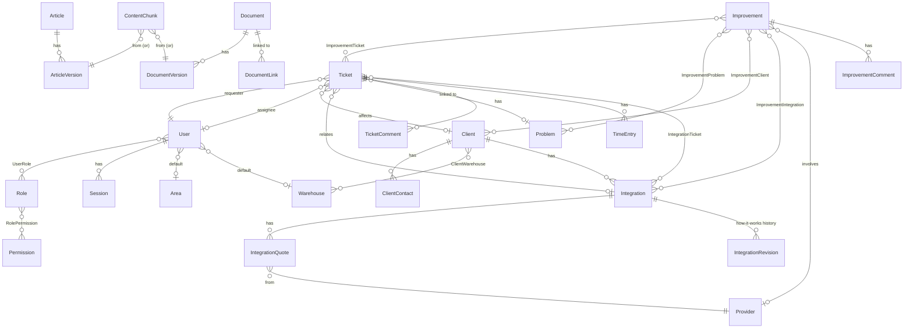
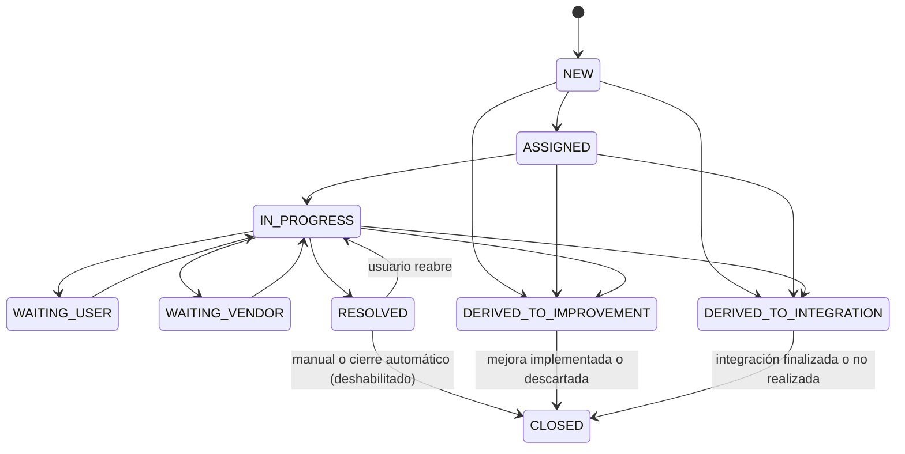
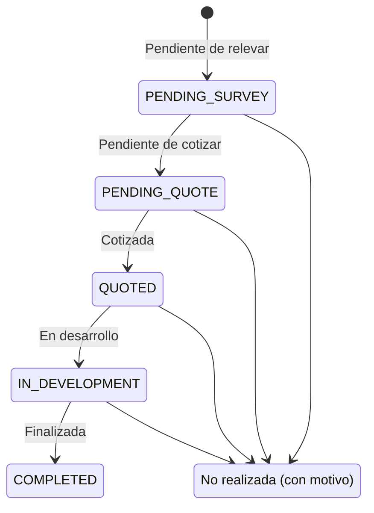

# Modelo de datos

Convenciones: IDs `uuid` (v7, ordenables), `createdAt`/`updatedAt` en todas las tablas, nombres en inglés, montos en `Decimal(14,2)` con moneda (`ARS` | `USD`), duraciones en minutos (`Int`).

## Diagrama general

## Identidad y seguridad

| Entidad                      | Campos principales                                                                                                                                                                                                                                                                                  | Notas                                                                                                                                                                                                          |
| ---------------------------- | --------------------------------------------------------------------------------------------------------------------------------------------------------------------------------------------------------------------------------------------------------------------------------------------------- | -------------------------------------------------------------------------------------------------------------------------------------------------------------------------------------------------------------- |
| `User`                       | email (único, se guarda en minúsculas), fullName, passwordHash, mustChangePassword, passwordChangedAt, status (`ACTIVE`\|`DISABLED`), defaultAreaId, defaultWarehouseId, mfaSecretEnc, mfaPendingSecretEnc, mfaEnabledAt, mfaLastUsedStep, failedLoginCount, lockedUntil, lastLoginAt, anonymizedAt | Secretos TOTP cifrados con AES-256-GCM (clave por env). `mfaLastUsedStep` impide reutilizar un código. Alta por Admin con contraseña temporal (`mustChangePassword`). SSO futuro: `externalIdentity` opcional. |
| `Role`                       | key, name, description, isSystem                                                                                                                                                                                                                                                                    | Admin, IT, User sembrados como `isSystem`.                                                                                                                                                                     |
| `Permission`                 | key (ej. `ticket.manage`), description                                                                                                                                                                                                                                                              | Sembrados por código; no editables desde la UI.                                                                                                                                                                |
| `RolePermission`, `UserRole` | —                                                                                                                                                                                                                                                                                                   | N:M.                                                                                                                                                                                                           |
| `Session`                    | tokenHash, userId, mfaVerified, createdAt, lastSeenAt, idleExpiresAt, expiresAt, revokedAt, ip, userAgent                                                                                                                                                                                           | Se guarda el SHA-256 del token; la cookie lleva el valor opaco.                                                                                                                                                |
| `MfaRecoveryCode`            | userId, codeHash, usedAt                                                                                                                                                                                                                                                                            | 10 códigos por usuario.                                                                                                                                                                                        |
| `AuditLog`                   | seq (bigserial), occurredAt, actorId, action, entityType, entityId, ip, metadata (JSON sin datos sensibles), prevHash, hash                                                                                                                                                                         | Append-only, ver [ADR 0008](adr/0008-immutable-audit-log.md).                                                                                                                                                  |

## Configuración y catálogos

| Entidad         | Campos                                                                                                                |
| --------------- | --------------------------------------------------------------------------------------------------------------------- |
| `SlaPolicy`     | ticketType, priority, firstResponseMinutes, resolutionMinutes (nullable)                                              |
| `BusinessHours` | weekday, startTime, endTime, timezone (`America/Argentina/Buenos_Aires`)                                              |
| `Holiday`       | date, name                                                                                                            |
| `Setting`       | key, value (JSON): `autoClose` `{enabled:false, businessDays:5}`, `email` `{enabled:false, ...}`, límites de archivos |
| `Warehouse`     | name (Garín, Pacheco), active                                                                                         |
| `Area`          | name, active                                                                                                          |
| `Provider`      | name (Interno, Molipa, SGL, TYT…), active                                                                             |

Valores iniciales de `SlaPolicy`:

| Tipo                                        | Prioridad    | 1ª respuesta   | Resolución     |
| ------------------------------------------- | ------------ | -------------- | -------------- |
| Problema / Pedido                           | Crítica      | 30 min         | 4 h hábiles    |
| Problema / Pedido                           | Alta         | 2 h            | 1 día hábil    |
| Problema / Pedido                           | Media        | 4 h            | 3 días hábiles |
| Problema / Pedido                           | Baja         | 1 día hábil    | 5 días hábiles |
| Propuesta de mejora / Pedido de integración | (cualquiera) | 2 días hábiles | —              |

## Tickets

| Entidad         | Campos                                                                                                                                                                                                                                                                                                                                                                                                                                                                                                                                                      |
| --------------- | ----------------------------------------------------------------------------------------------------------------------------------------------------------------------------------------------------------------------------------------------------------------------------------------------------------------------------------------------------------------------------------------------------------------------------------------------------------------------------------------------------------------------------------------------------------- |
| `Ticket`        | number (secuencia → `TLI-000123`), type, category, subject, description (HTML sanitizado), requesterId, assigneeId, clientId, warehouseId, areaId, userUrgency, priority, priorityIsProvisional, status, channel (`WEB`; a futuro `EMAIL`, `CHATBOT`), problemId, integrationId, firstResponseDueAt, resolutionDueAt, firstRespondedAt, slaPausedAt, slaPausedMinutes, slaFirstResponseState, slaResolutionState, resolutionCause, resolutionSolution, resolvedAt, closedAt, closeReason, extraFields (JSON: respuestas específicas del tipo), searchVector |
| `TicketComment` | ticketId, authorId, body, visibility (`PUBLIC`\|`INTERNAL`), source (`WEB`; a futuro `EMAIL`, `CHATBOT`, `SYSTEM`)                                                                                                                                                                                                                                                                                                                                                                                                                                          |
| `TimeEntry`     | ticketId, userId, minutes, workDate, note                                                                                                                                                                                                                                                                                                                                                                                                                                                                                                                   |
| `ActivityEvent` | entityType, entityId, actorId, kind (`CREATED`, `STATUS_CHANGED`, `FIELD_CHANGED`, `LINKED`…), field, oldValue, newValue, occurredAt                                                                                                                                                                                                                                                                                                                                                                                                                        |
| `Notification`  | userId, kind, entityType, entityId, title, readAt                                                                                                                                                                                                                                                                                                                                                                                                                                                                                                           |
| `Attachment`    | storageKey, originalName, mimeType, sizeBytes, sha256, scanStatus (`PENDING_SCAN`\|`CLEAN`\|`INFECTED`), scanDetail, uploadedById, ticketId, commentId, scannedAt                                                                                                                                                                                                                                                                                                                                                                                           |

`extraFields` guarda las preguntas que cambian según tipo (ej. propuesta: proceso actual, frecuencia, tiempo que lleva, beneficio esperado; integración: proceso, sentido, formato, volumen, fecha deseada). Se valida con un schema zod por tipo.

### Enums

- `TicketType`: `SUPPORT` (Soporte), `AUTOMATION` (Automatización), `INTEGRATION` (Integración), `ACCESS` (Acceso: alta, baja o cambio de permisos). Automatización e Integración solo tienen SLA de primera respuesta.
- `TicketCategory`: `WMS`, `TMS`, `TYT` (carga de pedidos de clientes), `ROUTING` (ruteador), `INTEGRATION`, `ACCESS`, `HARDWARE`, `NETWORK`, `OTHER`. Cada tipo admite solo algunas categorías (`CATEGORIES_BY_TYPE` en `@tli/shared`); Integración tiene la categoría fija `INTEGRATION` y en Acceso la categoría es el sistema. `ACCESS` como categoría queda solo por tickets históricos.
- Sector afectado: `warehouseId` **o** `areaId` (depósito o área, como Comercial o Calidad), o ninguno.
- Pedido de integración: `counterpartType` (`CLIENT` \| `CARRIER` (expreso) \| `OTHER`) y `counterpartName`, además de proceso, sentido, formato, volumen y fecha deseada.
- `Priority` / `Urgency`: `CRITICAL`, `HIGH`, `MEDIUM`, `LOW`
- `SlaState`: `ON_TRACK`, `AT_RISK`, `BREACHED`, `MET`, `STOPPED`

### Estados del ticket

Reloj de SLA: pausado en `WAITING_USER` y `WAITING_VENDOR`; detenido (`STOPPED`) en los estados derivados.

## Problemas

| Entidad   | Campos                                                                                                                                                                                              |
| --------- | --------------------------------------------------------------------------------------------------------------------------------------------------------------------------------------------------- |
| `Problem` | code (`PRB-0001`), title, description, category, rootCause, workaround, permanentSolution, status (`OPEN`\|`INVESTIGATING`\|`ROOT_CAUSE_IDENTIFIED`\|`RESOLVED`), ownerId, resolvedAt, searchVector |

Un ticket pertenece como máximo a un problema (`Ticket.problemId`).

## Mejoras

| Entidad                                                                                  | Campos                                                                                                                                                                                                                                                                                                                                                      |
| ---------------------------------------------------------------------------------------- | ----------------------------------------------------------------------------------------------------------------------------------------------------------------------------------------------------------------------------------------------------------------------------------------------------------------------------------------------------------- |
| `Improvement`                                                                            | code (`MEJ-0001`), title, system (`WMS`\|`TMS`\|`OTHER`), requestingAreaId, currentSituation, proposal, expectedImpact, impact (1–3), effort (1–3), priority (derivada de impacto × esfuerzo, ajustable), ownerId, providerId, estimatedCost, actualCost, currency, estimatedHours, actualHours, startDate, targetDate, completedAt, status, closingMessage |
| `ImprovementTicket`, `ImprovementProblem`, `ImprovementClient`, `ImprovementIntegration` | N:M                                                                                                                                                                                                                                                                                                                                                         |
| `ImprovementComment`                                                                     | improvementId, authorId, body (siempre interno)                                                                                                                                                                                                                                                                                                             |

Estados: `IDEA` → `ANALYSIS` → `APPROVED` → `IN_DEVELOPMENT` → `TESTING` → `IMPLEMENTED` \| `DISCARDED`. Al pasar a un estado final se exige `closingMessage`, que se publica como comentario público en todos los tickets vinculados al cerrarlos.

Implementación (Fase 4):

- Un ticket se deriva a **una** mejora: `Ticket.improvementId` en lugar de la tabla `ImprovementTicket`, igual que `Ticket.problemId`. Así el cierre en bloque no tiene ambigüedad. `ImprovementProblem` es una relación N:M implícita de Prisma.
- `system` admite `WMS`, `TMS`, `TYT`, `ROUTING` y `OTHER` (los mismos sistemas de la ticketera).
- Solo se derivan tickets abiertos. Quitar un ticket de una mejora en curso lo devuelve a `IN_PROGRESS`.
- El tiempo en un estado derivado cuenta como pausa del SLA: si el ticket vuelve, no se le cobra. Derivar cuenta como primera respuesta.
- Prioridad sugerida = impacto × (4 − esfuerzo): ≥ 6 Alta, ≥ 3 Media, si no Baja. "Crítica" solo a mano (`priorityIsManual`).
- Acciones realizadas: `ImprovementComment` (mejoras) y `ProblemAction` (problemas) registran qué se hizo, con adjuntos (`Attachment.improvementCommentId` / `Attachment.problemActionId`, mismo flujo de antivirus que los tickets). Son internas: los adjuntos solo los baja quien tiene `improvement.read` o `problem.read`.
- Los estados finales son terminales. `ImprovementClient` e `ImprovementIntegration` llegan en la Fase 5.

## Clientes e integraciones

| Entidad               | Campos                                                                                                                                                                                                                                                                                                                                                                                      |
| --------------------- | ------------------------------------------------------------------------------------------------------------------------------------------------------------------------------------------------------------------------------------------------------------------------------------------------------------------------------------------------------------------------------------------- |
| `Client`              | legalName, cuit (único, validado), shortName, status (`ACTIVE`\|`ONBOARDING`\|`INACTIVE`), notes                                                                                                                                                                                                                                                                                            |
| `ClientWarehouse`     | clientId, warehouseId                                                                                                                                                                                                                                                                                                                                                                       |
| `ClientContact`       | clientId, kind (`COMMERCIAL`\|`SYSTEMS`\|`OTHER`), name, email, phone, notes                                                                                                                                                                                                                                                                                                                |
| `Integration`         | clientId, name, processes[], systems[] (`WMS`\|`TMS`\|`TYT`\|`ROUTING`), direction (`INBOUND`\|`OUTBOUND`\|`BIDIRECTIONAL`), channel, format, frequency, location (carpeta/endpoint), requiresDevelopment, status, notDoneReason, notDoneNotes, howItWorks (HTML sanitizado), estimatedHours, actualHours, actualCost, currency, startDate, targetDate, goLiveDate, ownerId, originTicketId |
| `IntegrationRevision` | integrationId, howItWorks, authorId, createdAt — historial de "Cómo funciona"                                                                                                                                                                                                                                                                                                               |
| `IntegrationQuote`    | integrationId, providerId, amount, currency, estimatedHours, quotedAt, notes, isSelected, attachmentId                                                                                                                                                                                                                                                                                      |
| `IntegrationTicket`   | N:M para tickets relacionados (además del ticket de origen)                                                                                                                                                                                                                                                                                                                                 |

### Enums

- `IntegrationProcess`: `INBOUND_ORDERS`, `OUTBOUND_ORDERS`, `STOCK`, `DELIVERY_NOTES`, `CONFIRMATIONS`, `TRACKING`, `LABELS`, `OTHER`
- `IntegrationChannel`: `FTP_SFTP`, `NETWORK_FOLDER`, `EMAIL`, `API`, `EDI`, `MANUAL`
- `IntegrationFormat`: `CSV`, `FIXED_WIDTH_TXT`, `XML`, `JSON`, `EXCEL`
- `NotDoneReason`: `CLIENT_REJECTED_COST`, `TML_REJECTED_COST`, `OTHER`

Estados:

El costo estimado de la integración es el de la cotización marcada `isSelected`. "Integraciones pendientes" = estado distinto de `COMPLETED` y `NOT_DONE`.

Plantilla inicial de "Cómo funciona": Flujo · Origen y destino · Archivo · Validaciones y errores · Monitoreo · Contactos.

Implementación (Fase 5):

- Contraparte: `Integration.counterpartType` (`CLIENT`\|`CARRIER`\|`OTHER`). Con cliente se elige del maestro (`clientId`); con expreso u otro se guarda el nombre (`counterpartName`).
- Una integración cubre varios procesos (`processes`) y varios sistemas nuestros (`systems`), y se vincula (N:M) a plataformas externas del catálogo `Platform` (nombre + categoría `ECOMMERCE`\|`ERP`\|`OTHER`; iniciales: Mercado Libre, Tienda Nube, Shopify, Oracle, Odoo, SAP). El catálogo se edita en Administración → Catálogos.
- `direction` admite `null` ("a definir"), porque el pedido puede llegar con "No sé".
- Un ticket se deriva a una sola integración (`Ticket.integrationId`), igual que a una mejora; reemplaza `IntegrationTicket` y `originTicketId`. Al finalizar o no realizarse se exige `closingMessage` y se cierran los tickets derivados.
- "Cómo funciona" es texto plano con la plantilla; cada cambio guarda la versión anterior en `IntegrationRevision`. El texto enriquecido llega en la Fase 6.
- Cotizaciones con adjuntos (`Attachment.integrationQuoteId`). Acciones realizadas con adjuntos en `IntegrationAction`.
- Biblioteca básica: `Document` → `DocumentVersion` (cada una con su `Attachment`) → `DocumentLink` a `CLIENT` o `INTEGRATION`. Extracción de texto y OCR en la Fase 6.
- `Client.cuit` es opcional (alta en curso) y único; se valida el dígito verificador. Mejoras ↔ clientes es una relación N:M implícita.
- Importación del F50 (Excel de respuestas del formulario de alta): `Client.address`, `Client.f50Folio` (único, para reimportar sin duplicar) y `ClientContact.role` (área: Operaciones, Facturación, Tráfico…). Se cruza por CUIT, folio o razón social; en clientes existentes solo se completa lo vacío, se suman contactos nuevos y una baja se respeta (no se reactiva a nadie). Primero se previsualiza; nada se guarda hasta confirmar.
- El pedido de integración (ticket) guarda `extraFields.processes` (varios procesos) en lugar de `process`.

## Conocimiento y documentos

| Entidad                            | Campos                                                                                                                                                                                                                                                   |
| ---------------------------------- | -------------------------------------------------------------------------------------------------------------------------------------------------------------------------------------------------------------------------------------------------------- |
| `Article`                          | code, title, category (`WMS`\|`TMS`\|`INTEGRATIONS`\|`PROCEDURES`\|`FREQUENT_ERRORS`), template (`FREE`\|`ERROR_SHEET`), visibility (`INTERNAL`\|`PUBLIC`), status (`DRAFT`\|`PUBLISHED`\|`ARCHIVED`), currentVersionId, sourceTicketId, sourceProblemId |
| `ArticleVersion`                   | articleId, version, title, body (HTML), errorSymptom, errorCause, errorSolution, errorSteps, authorId, createdAt                                                                                                                                         |
| `Document`                         | title, description, system, category, visibility, currentVersionId, authorId                                                                                                                                                                             |
| `DocumentVersion`                  | documentId, version, attachmentId, extractionStatus (`PENDING`\|`DONE`\|`FAILED`), ocrUsed, pageCount, uploadedById                                                                                                                                      |
| `DocumentLink`                     | documentId, entityType (`CLIENT`\|`INTEGRATION`\|`IMPROVEMENT`\|`ARTICLE`), entityId, linkType (`SPECIFICATION`\|`LAYOUT`\|`SAMPLE_FILE`\|`MINUTES`\|`QUOTE`\|`MANUAL`\|`OTHER`)                                                                         |
| `Tag`, `ArticleTag`, `DocumentTag` | etiquetas N:M                                                                                                                                                                                                                                            |
| `ContentChunk`                     | sourceType (`ARTICLE`\|`DOCUMENT`\|`INTEGRATION`), articleVersionId \| documentVersionId \| integrationId, pageNumber, ordinal, text, visibility, contentHash, tokenCount, searchVector                                                                  |
| `ImportJob`                        | kind (`F50_CLIENTS`\|`BULK_DOCUMENTS`), status, createdById, totalItems, okItems, errorItems, report (JSON)                                                                                                                                              |

Los fragmentos se reemplazan completos por versión (borrar + insertar en transacción). Ver [ADR 0011](adr/0011-ai-readiness-chunks.md).

Implementación (Fase 6):

- Etiquetas como `String[]` en `Article.tags` y `Document.tags` (sin tablas `Tag`); alcanza para filtrar y buscar.
- `Document` suma `category`, `system` y `tags`; `DocumentVersion` suma `extractionStatus`, `extractionDetail`, `ocrUsed`, `pagesWithoutText` y `pageCount`.
- `ContentChunk.searchVector` es una columna generada (`tli_spanish`) con índice GIN. Solo se indexa la versión vigente de artículos y documentos, y el "Cómo funciona" de cada integración (siempre interno).
- La búsqueda aplica en SQL la visibilidad y los permisos (artículos publicados para quien no gestiona la base; documentos públicos, internos o vinculados a integraciones/clientes según permisos).
- Texto enriquecido (ADR 0009) en artículos, "Cómo funciona" y comentarios de tickets. El texto plano anterior se sigue mostrando tal cual; el HTML siempre pasa por el sanitizador del servidor. Las descripciones de tickets, problemas y mejoras siguen en texto plano.

## Sistemas y avisos de actualización (Fase 9)

| Entidad              | Campos                                                                                                                                                                                                                                               |
| -------------------- | ---------------------------------------------------------------------------------------------------------------------------------------------------------------------------------------------------------------------------------------------------- |
| `SystemInfo`         | key (`WMS`\|`TMS`\|`TYT`\|`ROUTING`), providerId, notes. Una fila por sistema, creada por el seed base con SGL como proveedor.                                                                                                                       |
| `DistributionList`   | name (único), description, emails (`String[]`, en minúsculas y sin repetir), active                                                                                                                                                                  |
| `UpdateAnnouncement` | number (`ACT-0001`), title, systems (`BusinessSystem[]`), reason, details, impact (`NONE`\|`DEGRADED`\|`OUTAGE`), startsAt, endsAt, status (`DRAFT`\|`SCHEDULED`\|`DONE`\|`CANCELLED`), reminderHours, sentAt, reminderSentAt, closedAt, closingNote |
| `AnnouncementSend`   | announcementId, kind (`NOTICE`\|`REMINDER`\|`DONE`\|`CANCELLED`), emailCount, userCount, emailed, sentById. No guarda las direcciones.                                                                                                               |

- Destinatarios de un aviso: N:M implícitas con `DistributionList`, `Warehouse` y `Area`. Se resuelven al enviar: mails de las listas activas + usuarios activos cuyo depósito o área por defecto coincide (deduplicados). Sale un mail por destinatario.
- El recordatorio lo manda el job `announcements.reminders` del worker (cada 5 min); se marca antes de enviar para no duplicarlo. Si se cambia el inicio, se vuelve a programar.
- Al anonimizar a un titular, su mail se quita de todas las listas.

## Índices relevantes

- `Ticket(status, assigneeId)`, `Ticket(requesterId, createdAt)`, `Ticket(resolutionDueAt) WHERE status IN (...)`.
- GIN sobre `searchVector` en `Ticket`, `Problem`, `ContentChunk`.
- GIN `gin_trgm_ops` sobre `Ticket.subject` y `Problem.title`.
- `AuditLog(entityType, entityId)`, `AuditLog(actorId, occurredAt)`.
